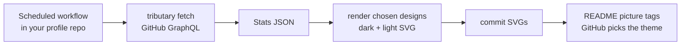

# tributary

SVG cards for a GitHub profile README that show where your open-source work goes: the PRs, issues and discussions you opened in other people's repositories, summed per repository, per owner, and per vendor family (for example AWS across aws, aws-samples, aws-cloudformation and more).

<picture>
  <source media="(prefers-color-scheme: dark)" srcset="gallery/lists/A03-repos-and-owners-dark.svg">
  
</picture>

## Status

Design phase. What exists:

- **[The design catalog](gallery/README.md)**: every card in GitHub dark and light, grouped by category. Each design has a stable id (`A03`, `D06`, …) to refer to it by.
- **The fetcher and aggregation**: everything a user opened, in about 30 GraphQL requests, turned into one `Stats` object.
- **Fixtures**: a real snapshot and a small synthetic account. Every design renders from both.

What's next: a config file for choosing designs and filters, and a GitHub Action that renders them into a profile repository on a schedule. See [decision 0003](docs/decisions/0003-static-svgs-from-actions.md).

## How it will work



No server is involved: GitHub shows README images as static ``, so a live endpoint would add hosting and rate limits without making anything interactive.

## Development

Tools come from `mise.toml` (Node 26 LTS and pnpm). Node runs the TypeScript sources directly.

```sh
pnpm install
pnpm gallery                         # render every design from fixtures/garysassano.json into gallery/
pnpm gallery sample-small --only A01 # render one design from another fixture
pnpm fetch <login> --out data.json   # fetch a fresh snapshot (uses GITHUB_TOKEN, else the gh CLI login)
pnpm check                           # lint, typecheck, markdown, tests
```

Adding a design: create `src/designs/<category>/<ID>-<slug>.ts` exporting a `Design`, list it in that folder's `index.ts`, and run `pnpm gallery`. The rules a card has to follow so it renders on GitHub are in [decision 0005](docs/decisions/0005-svg-rules-for-github-readmes.md).

## Decisions

Why TypeScript, why no server, why GraphQL connections, what counts as a contribution, and more: [docs/decisions](docs/decisions/README.md).

## Prior art

[github-readme-stats](https://github.com/anuraghazra/github-readme-stats) and [github-contribution-card](https://github.com/FrancoStino/github-contribution-card), both served live from Vercel. tributary differs in counting PRs, issues and discussions rather than commits, in grouping organizations into families, and in rendering ahead of time instead of on request.

## License

MIT
