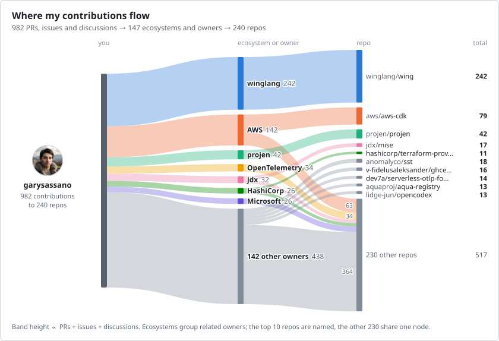
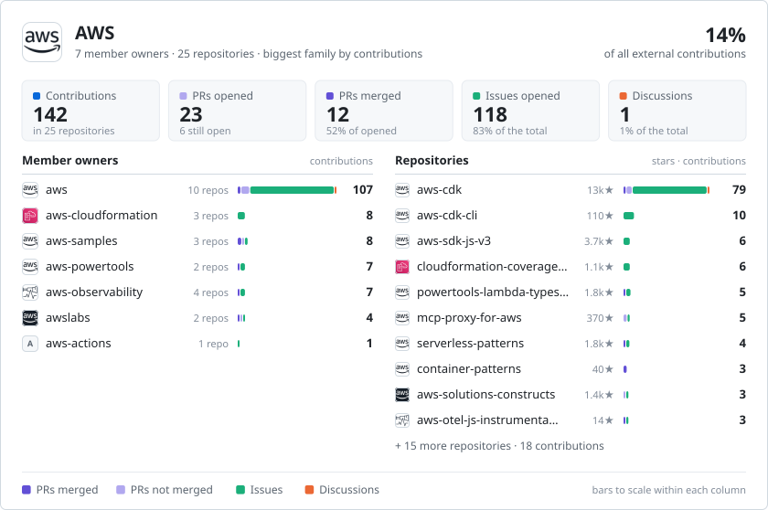
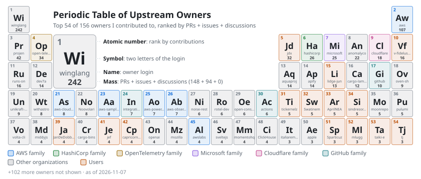
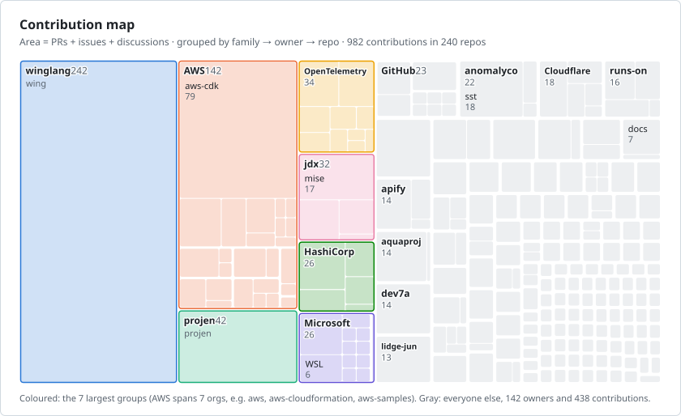
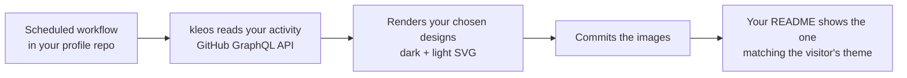

# kleos

> _κλέος_ (KLEH-os), ancient Greek: the renown a person earns through their deeds. Literally "what is heard" about you. In Homer, heroes don't claim it for themselves; other people carry it.

kleos does the same for open source. It turns the work you did in other people's projects into cards for your GitHub profile: the pull requests, issues and discussions you opened, summed per repository, per organization, and per vendor family (such as AWS across `aws`, `awslabs`, `aws-samples` and its other organizations).

<picture>
  <source media="(prefers-color-scheme: dark)" srcset="gallery/lists/A03-repos-and-owners-dark.svg">
  
</picture>

<table>
  <tr>
    <td width="50%"><a href="gallery/README.md#f--flows-and-networks"><picture><source media="(prefers-color-scheme: dark)" srcset="gallery/flows/F01-sankey-dark.svg"></picture></a> <b>F01</b> · Contribution Sankey</td>
    <td width="50%"><a href="gallery/README.md#d--visual"><picture><source media="(prefers-color-scheme: dark)" srcset="gallery/visual/D01-orbit-dark.svg"></picture></a> <b>D01</b> · Orbit</td>
  </tr>
  <tr>
    <td><a href="gallery/README.md#h--focus-and-stories"><picture><source media="(prefers-color-scheme: dark)" srcset="gallery/focus/H01-family-deep-dive-dark.svg"></picture></a> <b>H01</b> · Family deep-dive</td>
    <td><a href="gallery/README.md#g--badges-and-collectibles"><picture><source media="(prefers-color-scheme: dark)" srcset="gallery/collectibles/G03-periodic-table-dark.svg"></picture></a> <b>G03</b> · Periodic table of owners</td>
  </tr>
  <tr>
    <td><a href="gallery/README.md#b--charts"><picture><source media="(prefers-color-scheme: dark)" srcset="gallery/charts/B02-treemap-dark.svg"></picture></a> <b>B02</b> · Treemap</td>
    <td><a href="gallery/README.md#c--typographic"><picture><source media="(prefers-color-scheme: dark)" srcset="gallery/type/C02-terminal-dark.svg"></picture></a> <b>C02</b> · Terminal table</td>
  </tr>
</table>

**[Browse all 48 designs →](gallery/README.md)** The examples show the author's own contributions.

## How it works

kleos runs as a scheduled GitHub Action in your profile repository. There's no server to host and no shared rate limit to run into, and the cards update on whatever schedule you choose.
