# Design catalog

48 card designs, each rendered in GitHub dark and light from the `garysassano` snapshot taken 2026-11-07. GitHub shows the variant that matches your theme.

Regenerate with `pnpm gallery`. Do not edit the files here by hand.

- [A · Ranked lists](#a--ranked-lists) (6)
- [B · Charts](#b--charts) (6)
- [C · Typographic](#c--typographic) (6)
- [D · Visual](#d--visual) (6)
- [E · Compact and dashboards](#e--compact-and-dashboards) (6)
- [F · Flows and networks](#f--flows-and-networks) (6)
- [G · Badges and collectibles](#g--badges-and-collectibles) (6)
- [H · Focus and stories](#h--focus-and-stories) (6)

## A · Ranked lists

Evolutions of a classic profile card: rows of repositories or owners with a breakdown of what you contributed to each.

### A01 · Repo leaderboard

Top 12 upstream repos ranked by PRs + issues + discussions, each with a stacked bar showing the mix (merged PRs, other PRs, issues, discussions) and the counts beside it. When the top repo has more than twice the runner-up's total, its bar is shortened and labeled with its true total and “not to scale”, so the other bars stay readable. With outcomes "none" PRs are one segment; "merged" highlights merged PRs within them; "full" splits them into merged, open and closed unmerged.

`designs: A01` · 840 × 554 · outcomes: all levels

<picture><source media="(prefers-color-scheme: dark)" srcset="lists/A01-repo-leaderboard-dark.svg"></picture>

### A02 · Owner leaderboard

Top 12 orgs and people whose repos I contribute to, with repo count, a merged-PR gauge (merged of opened) and issue/discussion counts. Shows where PRs actually get merged versus where I mostly file issues. With outcomes "none" or "merged" the gauge becomes the PRs' share of each owner's total (merged highlighted at "merged"), with no rate; "full" splits the merge gauge into merged, open and closed unmerged.

`designs: A02` · 840 × 630 · outcomes: all levels

<picture><source media="(prefers-color-scheme: dark)" srcset="lists/A02-owner-leaderboard-dark.svg"></picture>

### A03 · Repos and owners

Four headline numbers, then the top 10 repos and top 10 owners side by side. Each row has a 100% bar showing what kind of contribution it was (PR-heavy vs issue-heavy), so the number carries size and the bar carries character.

`designs: A03` · 840 × 526 · outcomes: all levels

<picture><source media="(prefers-color-scheme: dark)" srcset="lists/A03-repos-and-owners-dark.svg"></picture>

### A04 · Repo table

A compact 15-row table with explicit columns (stars, PRs, merged, issues, discussions, total, active years) and a totals row for all upstream repos. Nothing to decode: every number has a header. With outcomes "none" the merged column goes; "full" adds open and closed columns.

`designs: A04` · 840 × 535 · outcomes: all levels

<picture><source media="(prefers-color-scheme: dark)" srcset="lists/A04-repo-table-dark.svg"></picture>

### A05 · Ecosystem rollup

Groups related GitHub owners into ecosystems (AWS: aws, aws-samples, …) with the ecosystem total on top and its owners, its top repos, or both indented below, so an ecosystem spread across many orgs shows up as one line.

`designs: A05` · 840 × 724 · outcomes: all levels

<picture><source media="(prefers-color-scheme: dark)" srcset="lists/A05-ecosystem-rollup-dark.svg"></picture>

Write settings after the id, such as `A05 owners=no repos=3`:

| Setting | Default | What it does |
| --- | --- | --- |
| `owners` | yes | List every owner under its ecosystem. An ecosystem with a single owner never gets an owner line. |
| `repos` | 0 (0–10) | How many top repos to list under each owner, or under the ecosystem when owners are off or it has one owner. An owner with a single repo names it on its own line. |

### A06 · Star tier vs my share

Star-tier letters (S+ to C) that say what they mean: the left side is the repo’s popularity (stars, log scale, tier letter), the right side is what I contributed there. Big repos with small bars and small repos with big bars become obvious. When the top repo has more than twice the runner-up's total, its bar is shortened and marked “not to scale”.

`designs: A06` · 840 × 626 · outcomes: all levels

<picture><source media="(prefers-color-scheme: dark)" srcset="lists/A06-star-tier-vs-my-share-dark.svg"></picture>

## B · Charts

Bars, treemaps, donuts, scatter plots and stacked areas of the same numbers.

### B01 · Stacked bars

The top 12 upstream repos as horizontal stacked bars (merged PRs, other PRs, issues, discussions) with the exact counts in aligned columns that double as the legend. With outcomes "none" PRs are one segment and column, "merged" shows PRs with the merged ones as a subset, and "full" splits merged, open and closed-unmerged PRs.

`designs: B01` · 840 × 462 · outcomes: all levels

<picture><source media="(prefers-color-scheme: dark)" srcset="charts/B01-stacked-bars-dark.svg">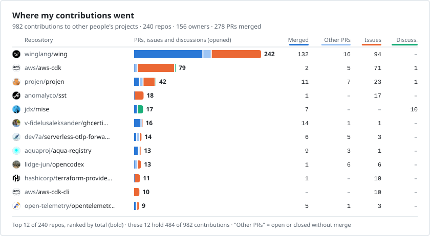</picture>

### B02 · Treemap

Every upstream repo as a tile sized by contributions, nested ecosystem → owner → repo, so the shape of the whole footprint (a few dominant blocks, a wide ecosystem spread, a long tail) is visible at a glance. The seven largest groups get colors.

`designs: B02` · 840 × 514 · outcomes: all levels

<picture><source media="(prefers-color-scheme: dark)" srcset="charts/B02-treemap-dark.svg"></picture>

### B03 · Donut

Share of all upstream work by ecosystem or owner as a donut (seven largest groups plus everyone else), next to a ranked table with avatars, share and a PR/issue breakdown per group. The PR part of that breakdown follows the outcomes level: PRs only, PRs with merged ones, or merged, open and closed-unmerged.

`designs: B03` · 840 × 418 · outcomes: all levels

<picture><source media="(prefers-color-scheme: dark)" srcset="charts/B03-donut-dark.svg">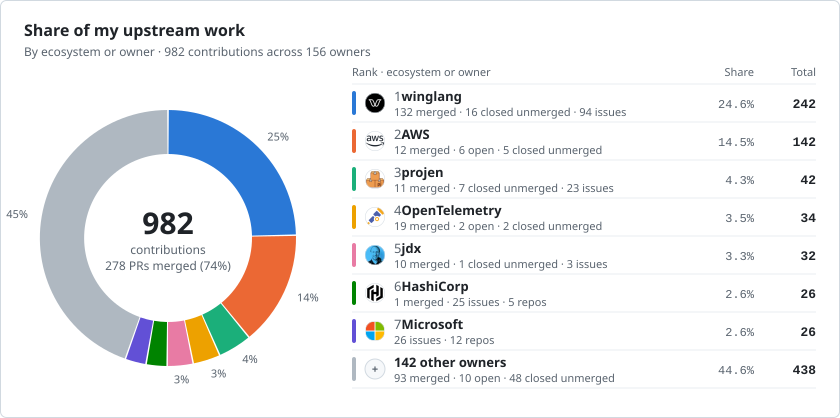</picture>

### B04 · Stars vs contributions

Each repo plotted by stars (log) against my contributions (log), colored by whether a PR was merged (with outcomes "none", only by whether I opened PRs; with "full", also open versus only closed-unmerged PRs); shows depth in mid-size repos versus drive-by issues on giant ones. Labels go to the 7 repos with most contributions, then the highest stars × contributions among repos with at least 3, up to 11 in all, each placed where it overlaps no other label and no other labelled repo's dot.

`designs: B04` · 840 × 462 · outcomes: all levels

<picture><source media="(prefers-color-scheme: dark)" srcset="charts/B04-stars-vs-contributions-dark.svg">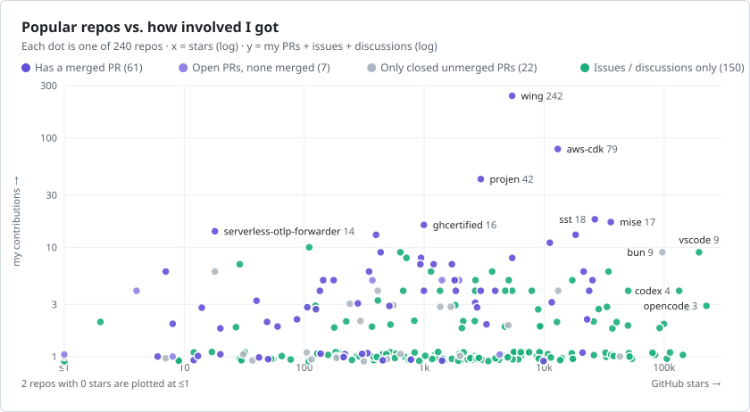</picture>

### B05 · Waffle

One square per contribution, grouped by ecosystem or owner, with merged PRs solid and everything else faded, so volume and code-vs-reports read together. With outcomes "none" every PR is solid; with "full" open PRs are outlined and closed-unmerged ones gray. Very large totals switch to one square per few contributions so the grid always fits.

`designs: B05` · 840 × 492 · outcomes: all levels

<picture><source media="(prefers-color-scheme: dark)" srcset="charts/B05-waffle-dark.svg">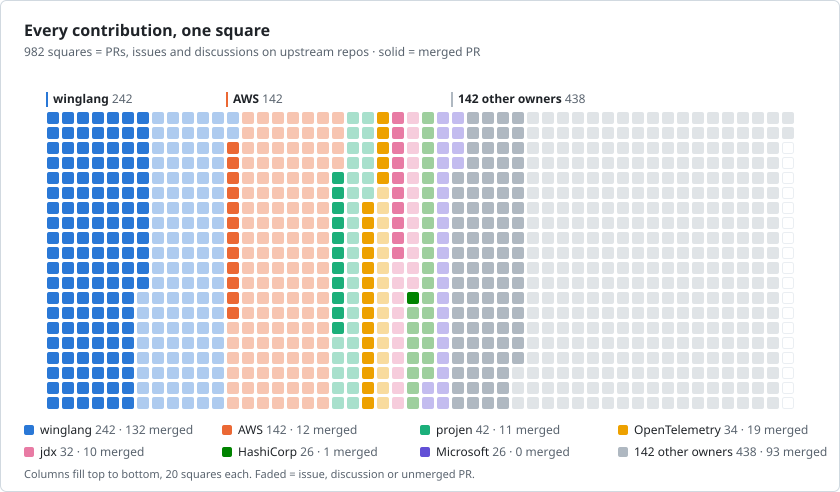</picture>

### B06 · Contributions over time

Monthly contributions as a stacked area by ecosystem or owner, showing peaks and how the mix shifts between groups. It starts in the first year holding at least 5% of all contributions; anything earlier is counted in the footnote.

`designs: B06` · 840 × 436 · outcomes: all levels

<picture><source media="(prefers-color-scheme: dark)" srcset="charts/B06-contributions-over-time-dark.svg"></picture>

## C · Typographic

Type-led layouts: big numbers, terminal output, ledgers, logs and indexes.

### C01 · Big numbers

Four large, labeled headline figures for upstream work (PRs opened, merged, issues, owners), with the five most active owners underneath. Reads in one glance. With outcomes none the merged figure gives way to repos; merged drops the merge rate; full adds open and closed-unmerged PRs.

`designs: C01` · 840 × 282 · outcomes: all levels

<picture><source media="(prefers-color-scheme: dark)" srcset="type/C01-big-numbers-dark.svg"></picture>

### C02 · Terminal

A fake `upstream --top 12` command that types itself out and prints an aligned monospace table of the top repos (language, stars, PRs, merged, issues, discussions), with a totals line. With outcomes none the merged column goes; full adds open and closed-unmerged columns.

`designs: C02` · 840 × 458 · outcomes: all levels

<picture><source media="(prefers-color-scheme: dark)" srcset="type/C02-terminal-dark.svg"></picture>

### C03 · Receipt

A till receipt itemized by owner, with ecosystems (several orgs under one name) rolled into one line each, a breakdown under each item and a grand total of every upstream PR, issue and discussion. The barcode is the last 53 weeks of activity. With outcomes none PRs are one line; merged keeps the merged sub-line without the open line or merge rate; full adds closed-unmerged PRs.

`designs: C03` · 440 × 831 · outcomes: all levels

<picture><source media="(prefers-color-scheme: dark)" srcset="type/C03-receipt-dark.svg">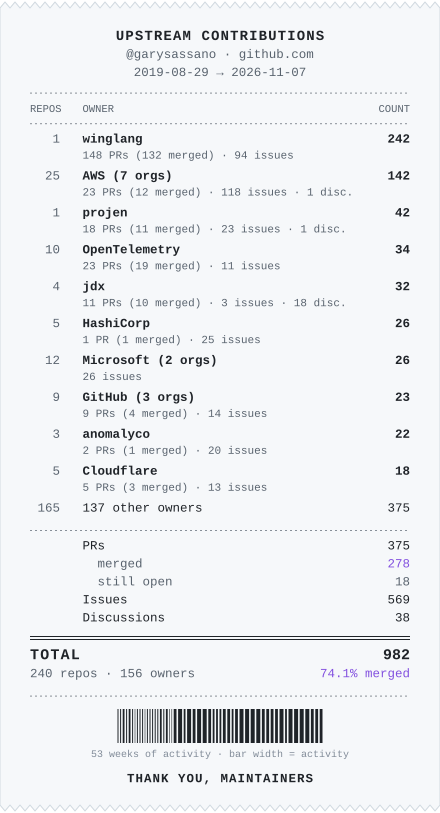</picture>

### C04 · Git log

The latest upstream PRs (merged and open; closed-unmerged ones are hidden) as a `git log --graph` timeline: date, repo#number, title and diffstat, so visitors see what you are working on right now. With outcomes none every node looks the same; merged fills merged nodes and leaves the rest plain; full lists closed-unmerged PRs too, each state with its own node.

`designs: C04` · 840 × 472 · outcomes: all levels

<picture><source media="(prefers-color-scheme: dark)" srcset="type/C04-git-log-dark.svg"></picture>

### C05 · In brief

A short paragraph written from the data: totals, merge count, the top three repos, the biggest ecosystem (the one with several owners and the most contributions) and this year's leading repo, with every figure set in bold. The merge count follows the outcomes level: left out for none, joined by open and closed-unmerged PRs for full.

`designs: C05` · 840 × 390 · outcomes: all levels

<picture><source media="(prefers-color-scheme: dark)" srcset="type/C05-in-brief-dark.svg">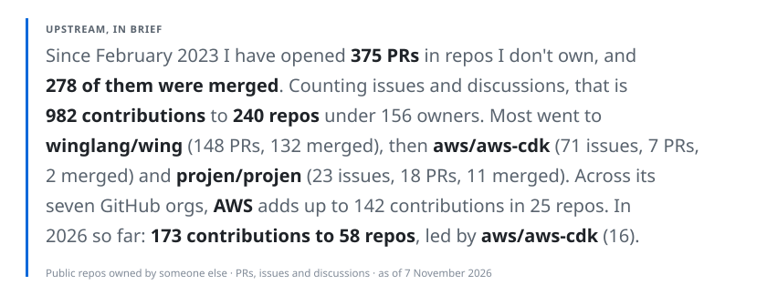</picture>

### C06 · Index

A typeset back-of-book index of the 30 most active owners, alphabetical with letter heads and dotted leaders to the contribution count. Calm, dense and easy to scan for a name.

`designs: C06` · 840 × 482 · outcomes: all levels

<picture><source media="(prefers-color-scheme: dark)" srcset="type/C06-index-dark.svg">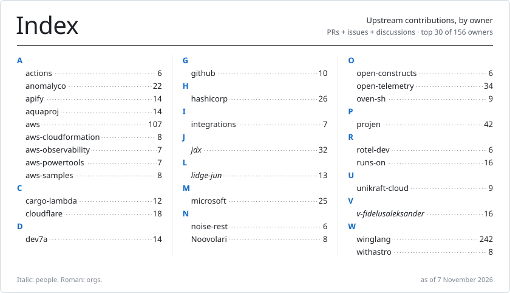</picture>

## D · Visual

Picture-first ideas: orbits, mosaics, heatmaps, timelines and skylines.

### D01 · Orbit

You at the center, every owner (org or person) you contributed to on a ring by how much (40+, 16–39, 9–15, 6–8), avatar size by total; dotted lines join owners of one ecosystem from the ecosystem list.

`designs: D01` · 840 × 676 · outcomes: all levels

<picture><source media="(prefers-color-scheme: dark)" srcset="visual/D01-orbit-dark.svg"></picture>

### D02 · Avatar mosaic

A treemap wall of avatars: each tile’s area is that owner’s share of all upstream contributions, with the count on every tile, a PR/issue breakdown on the big ones, and one tile pooling everyone with 5 or fewer.

`designs: D02` · 840 × 500 · outcomes: all levels

<picture><source media="(prefers-color-scheme: dark)" srcset="visual/D02-avatar-mosaic-dark.svg"></picture>

### D03 · Monthly heatmap

The 12 upstream repos with the most contributions as rows and every month from January of the year the earliest of them started as columns, with a bar strip of all upstream contributions per month on top, so bursts and long-running work both show.

`designs: D03` · 840 × 430 · outcomes: all levels

<picture><source media="(prefers-color-scheme: dark)" srcset="visual/D03-monthly-heatmap-dark.svg"></picture>

### D04 · Swimlanes

One lane per top upstream repo in the order I started on it: a line from first to last contribution and a dot per month sized by that month’s count, so the hand-offs between repos read like a timeline.

`designs: D04` · 840 × 512 · outcomes: all levels

<picture><source media="(prefers-color-scheme: dark)" srcset="visual/D04-swimlanes-dark.svg"></picture>

### D05 · Skyline

Each building is one of the top 15 owners (orgs or people), its height is the number of contributions and its floors split them into merged PRs, other PRs, issues and discussions, on a real scale with round-number gridlines. With outcomes "none" PRs are one floor; "full" splits them into merged, open and closed unmerged.

`designs: D05` · 840 × 520 · outcomes: all levels

<picture><source media="(prefers-color-scheme: dark)" srcset="visual/D05-skyline-dark.svg"></picture>

### D06 · Contribution calendar

The familiar 53-week activity calendar beside the five upstream repos with the most contributions in the months that window touches, so the year’s rhythm and where the upstream part went sit together.

`designs: D06` · 840 × 205 · outcomes: all levels

<picture><source media="(prefers-color-scheme: dark)" srcset="visual/D06-contribution-calendar-dark.svg">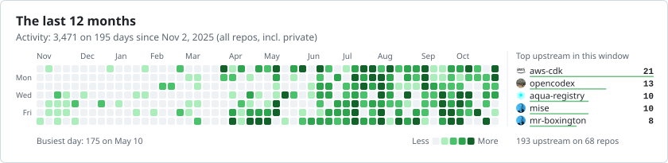</picture>

## E · Compact and dashboards

Small tiles and badges, single-repository spotlights and full dashboards.

### E01 · Stat tiles

Upstream PRs, merge rate, repos and owners as four equal 198px tiles in one 840px strip, each with a tiny supporting visual (contributions per year over the last four years, merge ring, top languages, top-owner avatars). Tiles rise in with a short staggered entrance. With outcomes "none" the merge tile goes and three tiles share the strip; "merged" shows merged PRs out of all PRs instead of a rate; "full" lists merged, open and closed beside the rate.

`designs: E01` · 840 × 118 · outcomes: all levels

<picture><source media="(prefers-color-scheme: dark)" srcset="compact/E01-stat-tiles-dark.svg"></picture>

### E02 · Owner badges

Shields.io-style pills, one per top owner (up to 24) with its avatar and a contribution count. Reads as a compact "who I contribute to" line and wraps to the README width.

`designs: E02` · 840 × 144 · outcomes: all levels

<picture><source media="(prefers-color-scheme: dark)" srcset="compact/E02-owner-badges-dark.svg">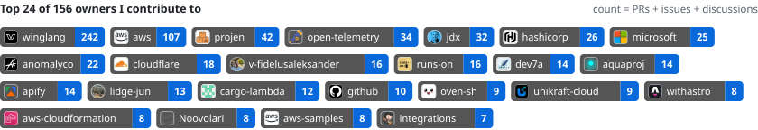</picture>

### E03 · Repo spotlight

One repo in focus: avatar, stars, language, PR/issue/discussion breakdown and a histogram of monthly contributions over the active span. It picks the repo with the most contributions among those not owned by the top owner. 410px, so two sit side by side.

`designs: E03` · 410 × 286 · outcomes: all levels

<picture><source media="(prefers-color-scheme: dark)" srcset="compact/E03-repo-spotlight-dark.svg">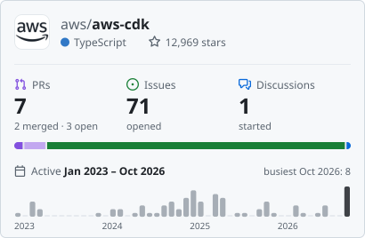</picture>

### E04 · Dashboard

Everything in one card: KPI strip, top owners with stacked contribution bars, top repos as a compact table, and a weekly activity strip for the last 12 months. Bars grow in on load.

`designs: E04` · 840 × 542 · outcomes: all levels

<picture><source media="(prefers-color-scheme: dark)" srcset="compact/E04-dashboard-dark.svg"></picture>

### E05 · GitHub-style list

Looks like a native GitHub list: an issues-style header with octicon tabs and counters, Box rows with blue repo links, language/owner label pills, dates and per-type counts.

`designs: E05` · 840 × 510 · outcomes: all levels

<picture><source media="(prefers-color-scheme: dark)" srcset="compact/E05-github-style-list-dark.svg">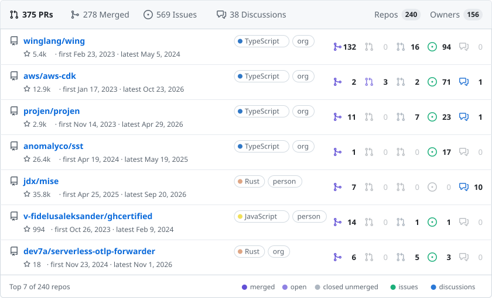</picture>

### E06 · Ecosystems (narrow)

A 420px card grouping work by ecosystem (several orgs under one name, such as AWS) with member-org avatars, scaled stacked bars and a written breakdown. Built to pair with another narrow card.

`designs: E06` · 420 × 480 · outcomes: all levels

<picture><source media="(prefers-color-scheme: dark)" srcset="compact/E06-ecosystems-narrow-dark.svg">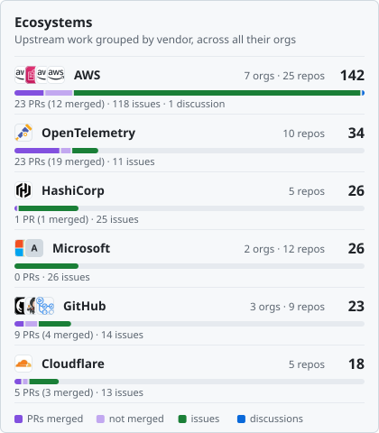</picture>

## F · Flows and networks

How contributions flow from you through ecosystems and owners to repositories, and how rankings shift.

### F01 · Sankey

A Sankey from you through ecosystems and owners to repos, band height proportional to PRs + issues + discussions. The 7 biggest groups and 10 biggest repos are named; the rest are merged into one node per column so every band still adds up.

`designs: F01` · 840 × 574 · outcomes: all levels

<picture><source media="(prefers-color-scheme: dark)" srcset="flows/F01-sankey-dark.svg"></picture>

### F02 · PR outcomes

An alluvial from the ecosystems and owners you opened PRs with to how they ended: merged, still open or closed without merging (GitHub's purple, green and red). The 8 groups with the most PRs are named with their merge rate; the rest share one node.

`designs: F02` · 840 × 538 · outcomes: full only

<picture><source media="(prefers-color-scheme: dark)" srcset="flows/F02-pr-outcomes-dark.svg">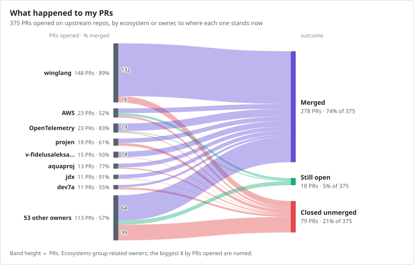</picture>

### F03 · Metro map

A subway map where each line is one of the 6 ecosystems or owners with the most repos (ties by contributions), and its stations are up to 8 of its biggest repos in order of first contribution, sized by PRs + issues + discussions. Shows breadth: where you branched out, not just where you contributed most.

`designs: F03` · 840 × 656 · outcomes: all levels

<picture><source media="(prefers-color-scheme: dark)" srcset="flows/F03-metro-map-dark.svg">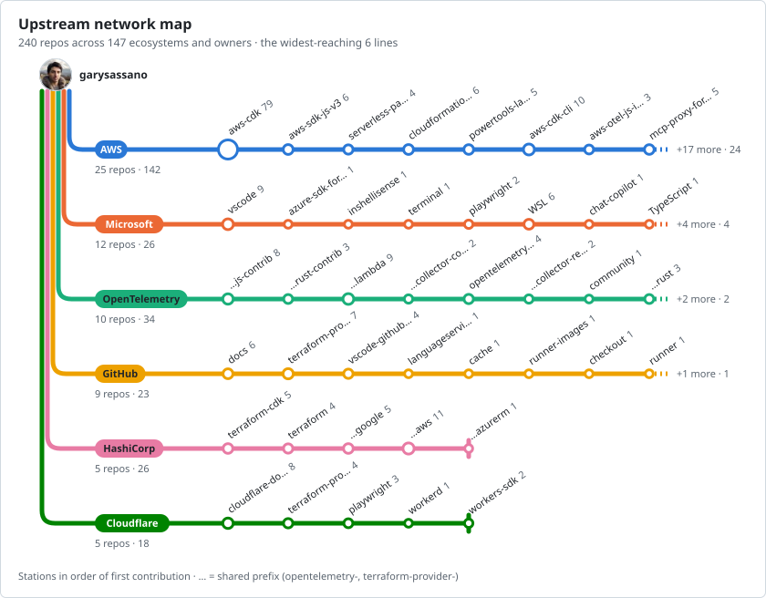</picture>

### F04 · Rank by year

A bump chart of the top 8 ecosystems and owners in each calendar year (from repos' monthly counts), so you can see who rose, who faded and who stayed. Years with fewer than 10 contributions are left out (the latest 6 are shown); the 7 biggest over those years get color, the rest stay gray.

`designs: F04` · 840 × 457 · outcomes: all levels

<picture><source media="(prefers-color-scheme: dark)" srcset="flows/F04-rank-by-year-dark.svg">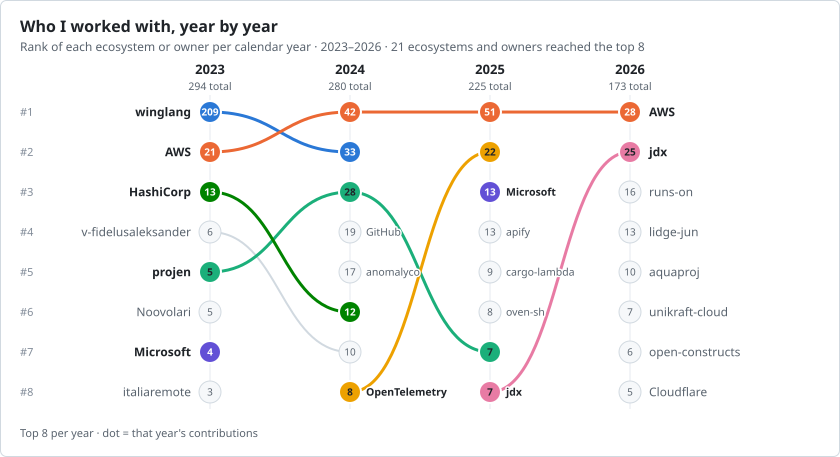</picture>

### F05 · First contact

How the network grew: owners grouped by the year of your first PR, issue or discussion with them (earliest repos[].first), with a bar for how many were new that year, the running total, and the biggest of each year's cohort. Leading years that each brought under 5% of owners fold into one column; at most 6 columns.

`designs: F05` · 840 × 416 · outcomes: all levels

<picture><source media="(prefers-color-scheme: dark)" srcset="flows/F05-first-contact-dark.svg">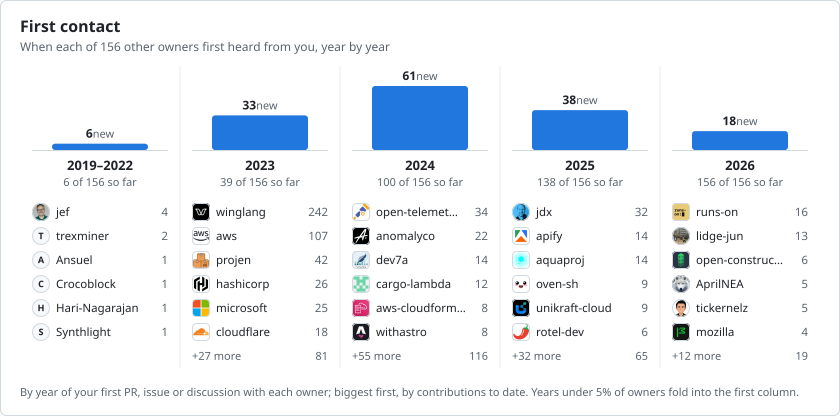</picture>

### F06 · Fan tree

A half-radial tree: you at the root, the 8 biggest ecosystems and owners on the inner ring, and up to 4 of each one's biggest repos as leaves, with stroke width proportional to PRs + issues + discussions. A compact picture of how the work branches out.

`designs: F06` · 840 × 570 · outcomes: all levels

<picture><source media="(prefers-color-scheme: dark)" srcset="flows/F06-fan-tree-dark.svg">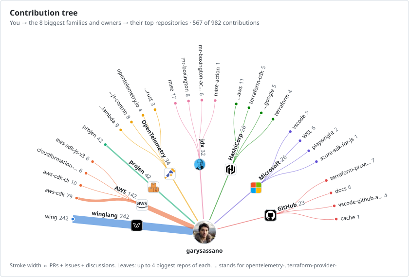</picture>

## G · Badges and collectibles

Playful formats such as trading cards, stamps and medals, with every number still real.

### G01 · Trading cards

The top three owners as collectible cards: avatar art, a stat block of PRs merged, PRs, issues and discussions, and a rarity tier from the total stars on the repos contributed to (thresholds printed in the legend). With outcomes none the merged row goes; full adds the merge rate and the open and closed-unmerged PRs beside the counts.

`designs: G01` · 840 × 422 · outcomes: all levels

<picture><source media="(prefers-color-scheme: dark)" srcset="collectibles/G01-trading-cards-dark.svg"></picture>

### G02 · Achievement medals

A sheet of eight medals, each computed from the data (most merged PRs in one repo, repos in one ecosystem, owners, issues, languages, stars, longest run, merge rate) and struck in bronze, silver or gold against thresholds printed under it. With outcomes none the merge medals count PRs instead and the merge rate becomes PRs opened; merged swaps the merge rate for merged PRs.

`designs: G02` · 840 × 482 · outcomes: all levels

<picture><source media="(prefers-color-scheme: dark)" srcset="collectibles/G02-achievement-medals-dark.svg">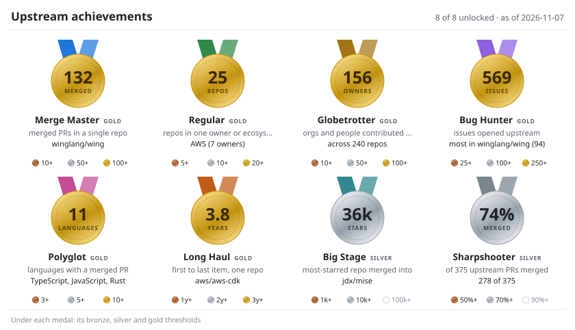</picture>

### G03 · Periodic table

The top 54 owners laid out in the first five periods of the periodic table: atomic number = rank, a unique two-letter symbol from the login, mass = PRs + issues + discussions. Ecosystems color their owners like element series; other owners are shown as orgs or people.

`designs: G03` · 840 × 358 · outcomes: all levels

<picture><source media="(prefers-color-scheme: dark)" srcset="collectibles/G03-periodic-table-dark.svg"></picture>

### G04 · Passport stamps

A passport page with one ink stamp for each of the top 12 owners by contributions, dated with my first PR, issue or discussion there and placed in order of that date; shape, ink and tilt come from a hash of the login so they never change between renders.

`designs: G04` · 840 × 528 · outcomes: all levels

<picture><source media="(prefers-color-scheme: dark)" srcset="collectibles/G04-passport-stamps-dark.svg">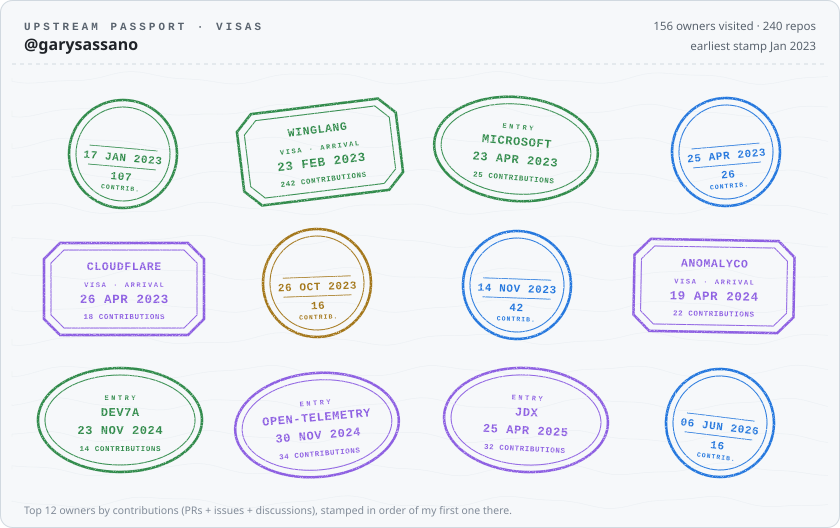</picture>

### G05 · Ticket stubs

The top six repos by contributions as admission tickets: the repo is the show, its stars and language the billing, PRs, merged, issues and discussions the printed fields, and the stub keeps the rank and total. The colored edge is the repo's language color. With outcomes none the merged field goes; full adds open and closed-unmerged fields.

`designs: G05` · 840 × 436 · outcomes: all levels

<picture><source media="(prefers-color-scheme: dark)" srcset="collectibles/G05-ticket-stubs-dark.svg">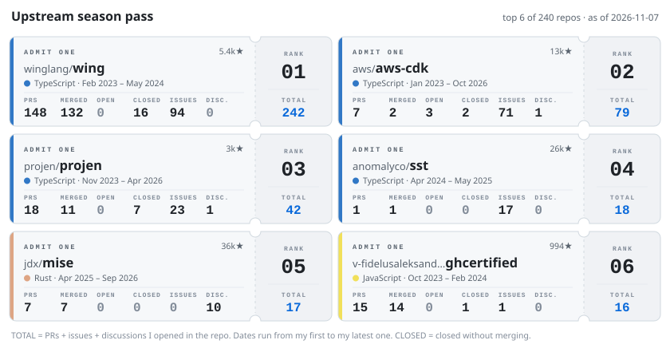</picture>

### G06 · Arcade high scores

A retro arcade high-score table in a bitmap font drawn from SVG pixels: the top ten owners ranked by score (PRs + issues + discussions in their repos) with PRs, merged PRs, issues and discussions as extra columns; the header shows the player, the top score and how many owners are on the board. With outcomes none the merged column goes; full adds open and closed-unmerged columns.

`designs: G06` · 840 × 512 · outcomes: all levels

<picture><source media="(prefers-color-scheme: dark)" srcset="collectibles/G06-arcade-high-scores-dark.svg">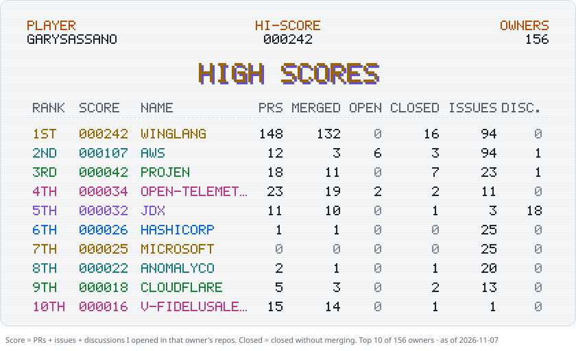</picture>

## H · Focus and stories

Deep dives into one ecosystem or repository, milestones and year-in-review stories.

### H01 · Ecosystem deep-dive

One ecosystem in depth: its member orgs, its repos and the PR, issue and discussion split, so a cluster like AWS reads as one relationship. Rule: the ecosystem with the most contributions (a lone top owner if no ecosystems are defined); up to 8 owners and 10 repos, the rest summed.

`designs: H01` · 840 × 558 · outcomes: all levels

<picture><source media="(prefers-color-scheme: dark)" srcset="focus/H01-ecosystem-deep-dive-dark.svg">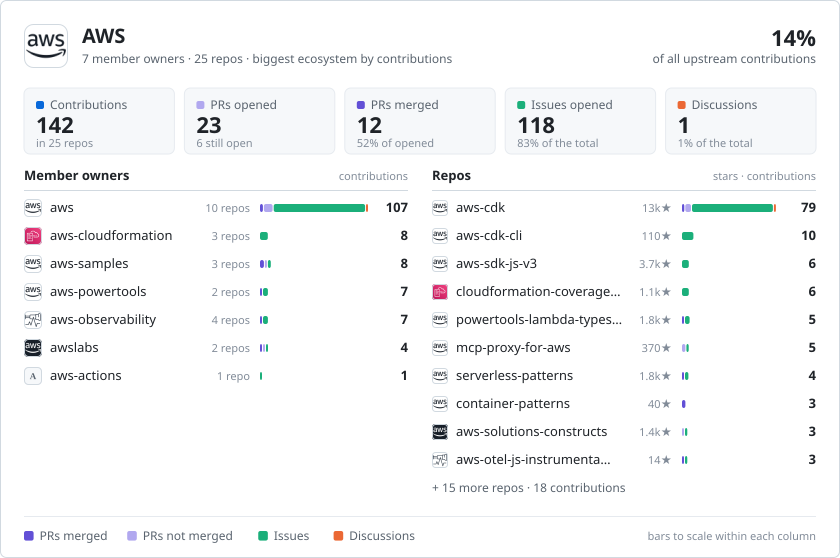</picture>

### H02 · Selected repos

A headline tile per notable repo, led by its total contribution count, each with its PR, issue and discussion counts and a strip of monthly contributions. Rule: the top 5 repos with at least 1,000 stars by contributions; if fewer than 3 qualify, the biggest remaining repos fill up to 3.

`designs: H02` · 840 × 430 · outcomes: all levels

<picture><source media="(prefers-color-scheme: dark)" srcset="focus/H02-selected-repos-dark.svg">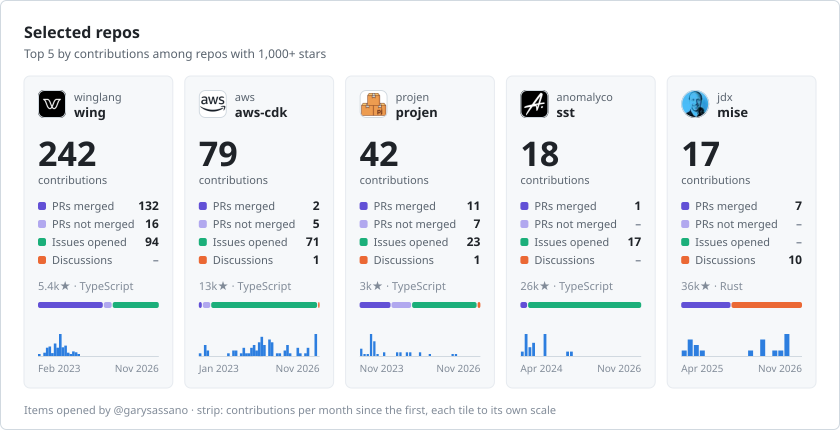</picture>

### H03 · Merge funnel

What happens to the PRs I open upstream: opened, decided (merged or closed), merged, with the drop at each step, then the same split for each ecosystem next to everyone else. Rule: ecosystems ranked by PRs opened, up to 7, the remaining owners summed in one row.

`designs: H03` · 840 × 356 · outcomes: full only

<picture><source media="(prefers-color-scheme: dark)" srcset="focus/H03-merge-funnel-dark.svg">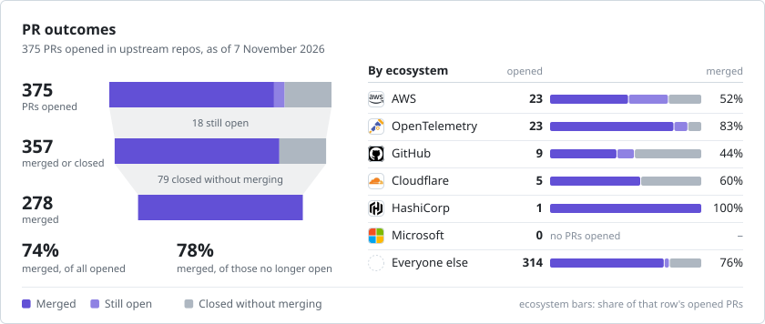</picture>

### H04 · Year in review

A wrapped-style story of one year upstream: contributions per month, the busiest month, the top repo and ecosystem, owners and repos contributed to for the first time, and the same months a year earlier. Rule: the year of the snapshot, or the latest year with contributions if it has none; a partial year is compared with the same months of the year before.

`designs: H04` · 840 × 304 · outcomes: all levels

<picture><source media="(prefers-color-scheme: dark)" srcset="focus/H04-year-in-review-dark.svg">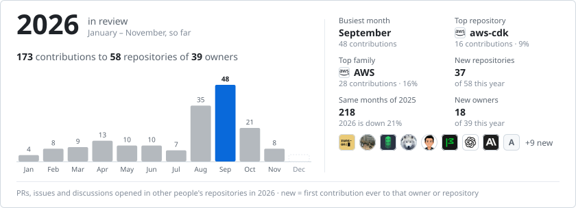</picture>

### H05 · Milestones

A timeline of firsts and round numbers derived from the data: the first upstream contribution, the 100th and 500th, the 10th and 100th repo, the first repo with 1k+ and with 10k+ stars, the first contribution to the biggest ecosystem, the busiest month, on a cumulative curve. Rule: at most 12 milestones, firsts kept before round numbers; month-only dates come from monthly counts; months without contributions are drawn at a fifth of the width on the axis.

`designs: H05` · 840 × 540 · outcomes: all levels

<picture><source media="(prefers-color-scheme: dark)" srcset="focus/H05-milestones-dark.svg">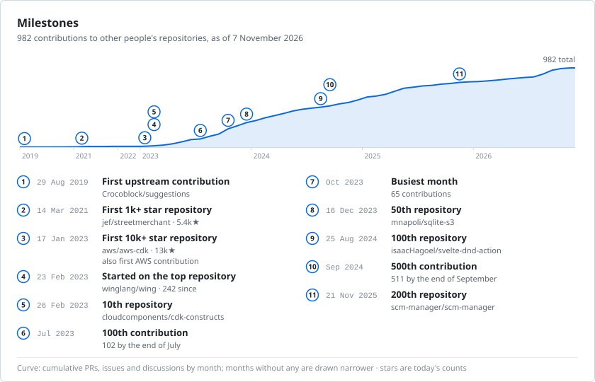</picture>

### H06 · Ecosystem vs ecosystem

The three biggest ecosystems side by side: total and share, each contribution kind on one shared scale with the leader in bold, merge rate, active span, top repo and member owners. Rule: the top 3 ecosystems by contributions; when there are fewer than 3, the biggest independent owners fill the remaining columns as groups of one.

`designs: H06` · 840 × 530 · outcomes: all levels

<picture><source media="(prefers-color-scheme: dark)" srcset="focus/H06-ecosystem-vs-ecosystem-dark.svg"></picture>
